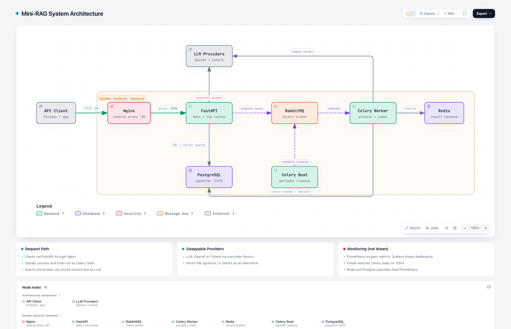

# DocuBrain

**A production-style Retrieval-Augmented Generation (RAG) API.** Upload your documents, index them as vector embeddings, and ask questions answered by an LLM that is grounded in your own content.


---

## Table of Contents

- [Overview](#overview)
- [Features](#features)
- [Architecture](#architecture)
- [Tech Stack](#tech-stack)
- [Project Structure](#project-structure)
- [Getting Started](#getting-started)
- [API Reference](#api-reference)
- [Monitoring](#monitoring)
- [Troubleshooting](#troubleshooting)
- [Acknowledgements](#acknowledgements)
- [License](#license)

---

## Overview

DocuBrain is a backend service that turns a collection of documents into a question-answering system:

1. **Upload** PDF or text files to a project.
2. **Process** them into overlapping text chunks.
3. **Index** each chunk as a vector embedding in PostgreSQL (pgvector).
4. **Search** semantically for the chunks most relevant to a question.
5. **Answer** the question with an LLM, using the retrieved chunks as context.

Heavy work (file processing and indexing) runs asynchronously on **Celery workers**, so the API stays fast and responsive.

## Features

- **Pluggable LLM providers**: OpenAI and Cohere for generation and embeddings, selected through a provider factory.
- **Pluggable vector stores**: pgvector (default) or Qdrant, behind a common interface.
- **Background processing**: Celery with RabbitMQ as the broker and Redis as the result backend.
- **Scheduled maintenance**: Celery Beat periodically cleans up old task-execution records.
- **Database migrations**: SQLAlchemy 2.0 (async) with Alembic.
- **Multilingual prompts**: RAG prompt templates in English and Arabic.
- **Observability**: Prometheus metrics, Grafana dashboards, and the Flower dashboard for Celery.
- **Deployment-ready**: Docker Compose stack with Nginx as a reverse proxy.

## Architecture

[](docs/architecture.html)

> Click the diagram to open the **interactive version** (download `docs/architecture.html` and open it in a browser).

**How a request flows:**

- Clients reach **FastAPI** through **Nginx**.
- Uploads are stored, then **processing and indexing tasks** are queued in **RabbitMQ**.
- The **Celery worker** splits files into chunks, creates embeddings with the LLM provider, and stores chunks and vectors in **PostgreSQL + pgvector**. Task results are kept in **Redis**.
- For **search and answers**, FastAPI queries pgvector for the closest chunks and sends them, with the question, to the LLM.
- **Celery Beat** schedules periodic cleanup jobs.

## Tech Stack

| Layer | Technology |
|---|---|
| API | FastAPI, Uvicorn, Pydantic Settings |
| LLMs | OpenAI, Cohere |
| Vector search | PostgreSQL 17 + pgvector (default), Qdrant (optional) |
| Database | SQLAlchemy 2.0 (async), asyncpg, Alembic |
| Document parsing | PyMuPDF, LangChain text splitters |
| Background jobs | Celery, RabbitMQ, Redis, Celery Beat, Flower |
| Monitoring | Prometheus, Grafana, Node Exporter, Postgres Exporter |
| Infrastructure | Docker Compose, Nginx |

## Project Structure

```
Mini-Rag/
├── src/
│   ├── main.py                 # FastAPI app and startup (DB, LLM, vector store clients)
│   ├── celery_app.py           # Celery configuration
│   ├── routes/                 # API endpoints: base, data, nlp
│   ├── controllers/            # Business logic: data, processing, NLP, projects
│   ├── models/                 # Data models, DB schemes and Alembic migrations
│   ├── stores/
│   │   ├── llm/                # LLM provider factory, OpenAI/Cohere, prompt templates
│   │   └── vectordb/           # Vector DB factory, pgvector/Qdrant providers
│   ├── tasks/                  # Celery tasks: file processing, indexing, maintenance
│   ├── utils/                  # Metrics and idempotency helpers
│   └── helpers/config.py       # Settings loaded from .env
├── docker/                     # Docker Compose stack, Nginx, Prometheus, RabbitMQ configs
└── docs/                       # Architecture diagram
```

## Getting Started

### Prerequisites

- **Python 3.10** (newer versions are not supported by some pinned packages)
- **Docker Desktop** (or Docker Engine + Compose)
- An **OpenAI** and/or **Cohere** API key
- Linux only: `sudo apt install libpq-dev gcc python3-dev`

### 1. Clone and create the environment

```bash
git clone <your-repo-url>
cd DocuBrain

conda create -n DocuBrain python=3.10 -y
conda activate DocuBrain

cd src
pip install -r requirements.txt
```

### 2. Configure environment variables

```bash
# Application settings
cp src/.env.example src/.env

# Docker services
cd docker/env
for f in app postgres grafana postgres-exporter rabbitmq redis; do
  cp .env.example.$f .env.$f
done
cd ../..
```

Then edit the files:

- `src/.env`: add your `OPENAI_API_KEY` / `COHERE_API_KEY`, and set `POSTGRES_PORT=5400` (the port Docker publishes Postgres on).
- Make sure the **passwords match** between `src/.env` and `docker/env/.env.postgres`, `.env.rabbitmq` and `.env.redis`.
- Give every numeric setting a value (for example `VECTOR_DB_PGVEC_INDEX_THRESHOLD = 100`). Empty values fail validation.

### 3. Start the infrastructure

```bash
cd docker
docker compose up -d pgvector rabbitmq redis
cd ..
```

### 4. Run database migrations

```bash
cd src/models/db_schemes/minirag
cp alembic.ini.example alembic.ini
# set: sqlalchemy.url = postgresql://postgres:<password>@localhost:5400/minirag
alembic upgrade head
cd ../../../..
```

### 5. Run the API and the worker

In one terminal:

```bash
cd src
uvicorn main:app --reload --host 0.0.0.0 --port 8000
```

In a second terminal:

```bash
cd src
python -m celery -A celery_app worker --queues=default,file_processing,data_indexing --loglevel=info
```

Optionally, in further terminals:

```bash
python -m celery -A celery_app beat --loglevel=info                 # scheduled cleanup
python -m celery -A celery_app flower --conf=flowerconfig.py        # dashboard on :5555
```

Open **http://localhost:8000/docs** for the interactive API documentation.

### Full Docker deployment

To run everything (API, workers, Nginx and monitoring) in containers:

```bash
cd docker
docker compose up -d
```

## API Reference

All endpoints are prefixed with `/api/v1`.

| Method | Endpoint | Description |
|---|---|---|
| `GET` | `/api/v1/` | Health check: app name and version |
| `POST` | `/api/v1/data/upload/{project_id}` | Upload a file to a project |
| `POST` | `/api/v1/data/process/{project_id}` | Split uploaded files into chunks (background task) |
| `POST` | `/api/v1/data/process-and-push/{project_id}` | Process and index in one workflow |
| `POST` | `/api/v1/nlp/index/push/{project_id}` | Embed chunks and store them in the vector DB |
| `GET` | `/api/v1/nlp/index/info/{project_id}` | Get vector collection info |
| `POST` | `/api/v1/nlp/index/search/{project_id}` | Semantic search over the project |
| `POST` | `/api/v1/nlp/index/answer/{project_id}` | Answer a question using RAG |

A ready-made Postman collection is available at [`src/assets/mini-rag-app.postman_collection.json`](src/assets/mini-rag-app.postman_collection.json).

**Typical workflow:** `upload` → `process` → `push` → `search` / `answer`

## Monitoring

| Service | URL |
|---|---|
| API docs | http://localhost:8000/docs |
| Flower (Celery) | http://localhost:5555 |
| Grafana | http://localhost:3000 |
| Prometheus | http://localhost:9090 |
| RabbitMQ management | http://localhost:15672 |

## Troubleshooting

| Problem | Fix |
|---|---|
| `pip install` fails on PyMuPDF or pgvector | Use **Python 3.10** (`python --version`). |
| `[Errno 48] Address already in use` on port 5000 | macOS AirPlay Receiver uses port 5000. Use `--port 8000`. |
| `the greenlet library is required` | `pip install greenlet` (not installed automatically on Apple Silicon). |
| `Connection refused` to Postgres | Start Docker services and set `POSTGRES_PORT=5400`. |
| `password authentication failed` | Make `src/.env` and `docker/env/.env.postgres` use the same password. Postgres only reads it when its volume is first created. |
| `Can't load plugin: sqlalchemy.dialects:driver` | Set a real `sqlalchemy.url` in `alembic.ini`. |
| `404 Not Found` at `/` | Expected. Routes start with `/api/v1`; see `/docs`. |

## License

Distributed under the terms of the [LICENSE](LICENSE) file in this repository.
